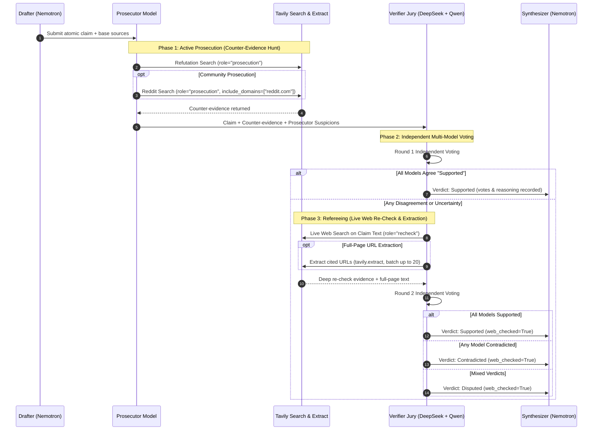

# Vera — Research that knows you, and proves it.

> Deep research tools give every user the same stateless answer and cite sources nobody checked.  
> Vera remembers who you are and what you already researched, then adversarially verifies every single claim across multiple NVIDIA open models before it reaches you.

[](docs/Submissions.md)
[](https://build.nebius.com/)
[](docs/DECISIONS.md)
[](https://tavily.com/)
[](backend/tests/)
[](docs/ARCHITECTURE.md)
[](LICENSE)

---

## ⚡ Quickstart & Setup Instructions

Get Vera running locally in under 3 minutes.

### 📋 Prerequisites
- **Python**: `3.10` or higher (`3.11` recommended)
- **Node.js**: `18.0` or higher (Node `20+` recommended) & `npm`
- **Nebius Token Factory API Key**: [Get API Key at build.nebius.com](https://build.nebius.com/)
- **Tavily Search API Key**: [Get API Key at tavily.com](https://tavily.com/)

---

### 1️⃣ Clone & Configure Environment

```bash
git clone https://github.com/Siddhant75/vera.git
cd vera

# Copy environment template
cp .env.example .env
```

Edit `.env` and fill in your keys:
```env
TOKEN_FACTORY_API_KEY=your_nebius_api_key_here
TAVILY_API_KEY=your_tavily_api_key_here
TOKEN_FACTORY_BASE_URL=https://api.tokenfactory.nebius.com/v1

# Models served on Nebius Token Factory
PLANNER_MODEL=nvidia/nemotron-3-super-120b-a12b
VERIFIER_MODELS=deepseek-ai/DeepSeek-V4-Pro,Qwen/Qwen3-235B-A22B-Instruct-2507
```

---

### 2️⃣ Start Backend Server (FastAPI)

In your first terminal:
```bash
# Navigate to backend
cd backend

# Create & activate virtual environment
python -m venv .venv

# Windows (PowerShell):
.venv\Scripts\Activate.ps1
# macOS / Linux:
source .venv/bin/activate

# Install dependencies
pip install -r requirements.txt

# Run backend server (starts on http://localhost:8000)
uvicorn app.main:app --reload --host 127.0.0.1 --port 8000
```
Verify backend health: `curl http://127.0.0.1:8000/api/telemetry`

---

### 3️⃣ Start Frontend Server (Vite + React)

In a second terminal:
```bash
cd frontend

# Install dependencies
npm install

# Start Vite dev server (starts on http://localhost:5173)
npm run dev
```

Open **`http://localhost:5173`** in your browser.

---

### 4️⃣ Running Test Suites & Verification

Vera has a comprehensive, 100% mock-isolated test suite that verifies the entire pipeline without consuming real API credits:

```bash
# Run all 202 backend tests (runs in ~12 seconds)
pytest backend/tests

# Run frontend linter and production bundle build
cd frontend
npm run lint
npm run build
```

---

## 🎯 Guidance for Running & Testing Vera

Once the app is open at `http://localhost:5173`:

1. **Test the Hero Run**:
   - The sample brief (*"Should our startup adopt Kubernetes or serverless for our new ML inference API?"*) is pre-filled.
   - Click **Run Research** and observe the live multi-agent execution stream in real time.
2. **Observe Dual-Tier Telemetry**:
   - Notice the telemetry banner at the top: `⚡ THIS RUN (~49k-120k tokens)` is cleanly separated from `🌐 SESSION TOTAL`, so you always know the exact marginal cost of a single research query.
3. **Inspect the Adversarial Verification Moat**:
   - Scroll to the **Verified Claims** section. The first claim is auto-expanded by default.
   - View the **`⚖️ Prosecutor's counter-evidence hunt`** where the prosecutor actively searched for contradictions, and inspect the independent **Model Votes** (Nemotron, DeepSeek, Qwen).
4. **Switch to Full Research Draft Mode**:
   - Click the **Full Research Draft (Markdown)** tab at the top of the report.
   - View the complete compiled markdown document with section headings, inline verdict tags, and bibliography.
   - Click **📋 Copy Draft to Clipboard** for instant export into Obsidian, Notion, or Google Docs.
5. **Inspect the Tavily Transparency Pool**:
   - Switch back to the Executive Report and scroll down past the **16 Authoritative Domain Cards** to the **Transparency Pool (Evaluated Web Evidence)**.
   - Expand the card to inspect the exact web sources Tavily fetched that Vera's agents pruned to prevent hallucinated trivia.
6. **Test the Delta Engine ("What Changed")**:
   - With the topic tag set to `k8s vs serverless`, click **Run Delta (what changed)**.
   - Notice how reused questions skip the pipeline, and Vera renders the **What changed since your last research** box highlighting updated, confirmed, and contradicted claims.
7. **Test Private Notes & Memory Restoration**:
   - Expand **🔒 Private notes** and add internal context (e.g., *"we are bound to k8s by a platform mandate"*). Notice the deterministic privacy gate keeps confidential tokens off search engines.
   - Open **🧠 What Vera remembers** and click **View ↗** on any past run to immediately reload its report and restore its exact telemetry.

---

## 🚀 How NVIDIA Nemotron & Open Models Power Vera

Single-model architectures create an echo chamber: if you ask a model to verify its own draft, it suffers from self-confirmation bias and sycophancy. Vera solves this by treating verification as an adversarial trial powered by **diverse open-source models** served on **Nebius Token Factory**:

```
                       ┌──────────────────────────────────────────────┐
                       │   NVIDIA Nemotron-3-Super-120B (Planner)    │
                       │   - Decomposes brief into persona questions │
                       └──────────────────────┬───────────────────────┘
                                              │
                       ┌──────────────────────▼───────────────────────┐
                       │   NVIDIA Nemotron-3-Super-120B (Drafter)    │
                       │   - Extracts atomic claims with source URLs │
                       └──────────────────────┬───────────────────────┘
                                              │
                       ┌──────────────────────▼───────────────────────┐
                       │             Adversarial Verification         │
                       │  - Prosecutor hunts counter-evidence (Tavily)│
                       │  - Independent Jury:                         │
                       │    * NVIDIA Nemotron                         │
                       │    * DeepSeek-V4-Pro                         │
                       │    * Qwen3-235B-Instruct                     │
                       └──────────────────────┬───────────────────────┘
                                              │
                       ┌──────────────────────▼───────────────────────┐
                       │   NVIDIA Nemotron-3-Super-120B (Synthesizer)│
                       │   - Verdict-weighted Executive Report        │
                       │   - Full Unabridged Markdown Draft           │
                       └──────────────────────────────────────────────┘
```

### 1. NVIDIA Nemotron-3-Super-120B: The Orchestration Core
- **Planning & Persona Decomposition**: Nemotron analyzes the user's role (`engineer`, `founder`, or `analyst`) and breaks complex briefs into 3 to 8 targeted sub-questions. It determines depth tiers (`quick`, `standard`, `deep`) and enforces deterministic search ceilings.
- **Strict Citation-Grounded Drafting**: Nemotron synthesizes fetched web content into atomic, testable claims. It is constrained to only extract assertions with mandatory source URLs—preventing fabricated citations before verification even begins.
- **Executive Synthesis & Markdown Compilation**: Nemotron synthesizes the final report, generating a punchy **Bottom Line (≤80 words)**, narrative sections weighted by claim verdicts, and compiling the full research draft for 1-click Markdown export.

### 2. The Multi-Model Jury: DeepSeek-V4-Pro + Qwen3-235B
- **Independent Quorum**: Vera passes the drafted claims and the prosecutor's counter-evidence to a multi-model jury consisting of `deepseek-ai/DeepSeek-V4-Pro` and `Qwen/Qwen3-235B-A22B-Instruct-2507`.
- **Adversarial Dispute Resolution**: If the models disagree on whether a claim is supported, Vera doesn't take an average—it initiates a live web referee re-check with full-page text extraction (`tavily.extract`) to resolve the discrepancy with primary evidence.

---

## ⚡ How Nebius Token Factory Accelerated Our Workflow

Developing an adversarial, multi-agent research assistant requires orchestrating dozens of concurrent LLM calls per query. **Nebius Token Factory** was instrumental to building Vera:

1. **Ultra-Low Latency & High Token Throughput**:
   - A single deep-research query involves up to 40 LLM interactions across planning, drafting, prosecutor hypotheses, and multi-model jury voting.
   - Nebius Token Factory's optimized inference infrastructure allowed Vera to execute full 120,000-token multi-model research runs in **~45 seconds**, eliminating the latency bottlenecks common in traditional API providers.
2. **Unified OpenAI-Compatible API Gateway**:
   - Nebius Token Factory hosts heterogeneous state-of-the-art open models (NVIDIA Nemotron, DeepSeek, Qwen) behind a **single standardized API endpoint** (`https://api.tokenfactory.nebius.com/v1`).
   - This eliminated the need to maintain different SDKs, credential managers, or protocol adapters. Our Python `httpx` asynchronous client communicates with all three models seamlessly.
3. **Predictable Per-Token Economics**:
   - Token Factory's transparent pricing made it possible to build Vera's **dual-tier telemetry engine**. Vera measures exact input/output tokens in real time, giving users total confidence in the cost-efficiency of every run (~49k–120k tokens per query).
4. **Concurrency Without Throttling**:
   - When the verifier broadcasts claims to multiple jury models simultaneously, Token Factory handles the parallel fan-out without rate-limit drops or queue stalling.

---

## 🔍 Tavily 6-Role Integration Matrix (Best Use of Tavily)

Vera does not use Tavily as a simple search bar replacement. Instead, Tavily acts as an active referee embedded across **six distinct operational roles**:

| Role | API Endpoint / Mode | Search Strategy & Filters | Pipeline Purpose |
| :--- | :--- | :--- | :--- |
| **1. Grounding** | `/search` | `include_domains_mode: "prefer"`, `exclude_domains` | Gathers initial live web evidence per sub-question, prioritizing user-trusted domains. |
| **2. Active Prosecution** | `/search` | `exclude_domains` (unbiased by trusted sources) | Searches explicitly for counter-evidence, disproven benchmarks, and contradictory facts. |
| **3. Community Prosecution** | `/search` | `include_domains: ["reddit.com"]` | Mines real-world practitioner experiences, post-mortems, and deployment complaints on Reddit. |
| **4. Referee Re-Check** | `/search` (role=`recheck`) | Precise claim text query, fresh indexing | Triggered automatically when jury models disagree to fetch tie-breaking evidence. |
| **5. Full-Page Extraction** | `/extract` | Batch up to 20 URLs cited by the claim | Pulls full-page DOM markdown to resolve snippet truncation errors when claims are disputed. |
| **6. Transparency Pool** | In-memory diff | Trust-filtered, cited sources removed | Surfaces up to 30 evaluated but discarded web sources with clear provenance explanation. |

---

## 🏛️ Architecture & Verification Flow



For complete C4 architecture models, component diagrams, and SQLite database schemas, see **[docs/ARCHITECTURE.md](docs/ARCHITECTURE.md)**.

---

## 🏆 Hackathon Tracks & Alignment

### 1. Personal AI Track ($3,000+ Prize)
- **Persistent Personal Memory**: Remembers who you are across sessions (`vera.db` SQLite).
- **Dynamic Persona Adaptation**: Deep briefs adapt terminology, depth, and tone for Engineers, Founders, or Analysts.
- **Deterministic Privacy Gate**: Private internal constraints steer the research without leaking confidential tokens to external search engines.
- **The Delta Engine**: Remembers past research on a topic, running fast, token-efficient delta runs that highlight only what changed.
- **Continuous Topic Watcher**: Researches topics in the background on schedule, probe-gated so it never burns tokens unless the web changes.

### 2. Best Use of Tavily Prize ($3,000 Prize)
- **6-Role Search Architecture**: Grounding, Prosecution, Reddit Community Search, Referee Re-Check, Full-Page Extraction, and the Transparency Pool.
- **Tavily Transparency Pool**: Full provenance surfacing web sources evaluated and pruned during verification.
- **Zero Hallucinated Citations**: Every claim is strictly bound to valid URLs with rich domain cards.

### 3. Grand Prize Contender
- Fully open-weights multi-model architecture.
- 202 unit and integration tests passing.
- Production-grade UI with dual-tier telemetry, Markdown export, and live SSE streaming.

---

## 📄 License

Apache 2.0 — Original implementation engineered for the Nebius x NVIDIA Global AI Hackathon.
