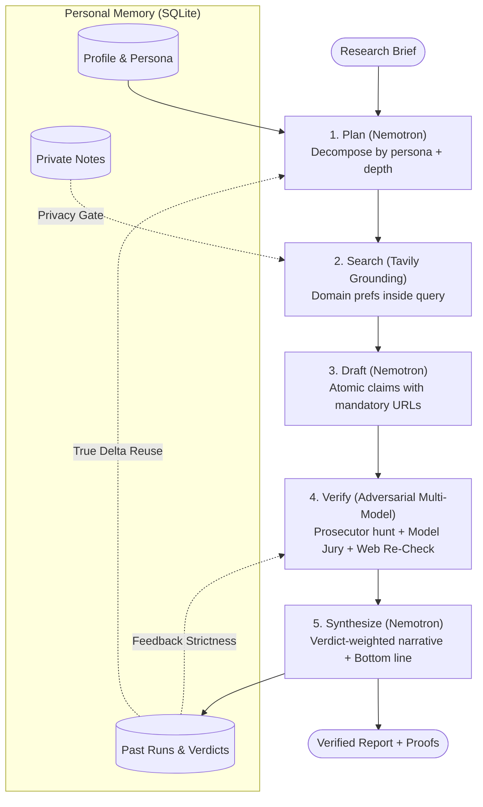
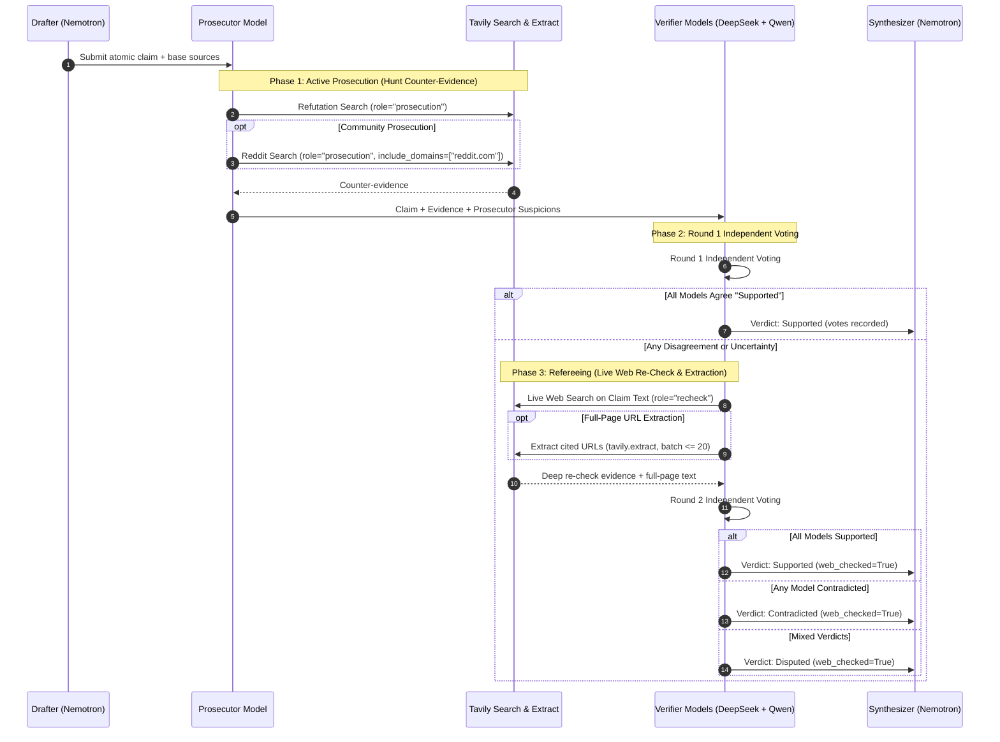

# Vera — Research that knows you, and proves it.

> Deep research tools give every user the same stateless answer and cite sources nobody checked.  
> Vera remembers who you are and what you already researched, then adversarially verifies every single claim across multiple NVIDIA open models before it reaches you.

[](docs/Submissions.md)
[](https://build.nebius.com/)
[](docs/DECISIONS.md)
[](https://tavily.com/)
[](backend/tests/)
[](docs/ARCHITECTURE.md)
[](LICENSE)

---

## ⚡ 30-Second Quickstart

- **Live Demo:** [demo URL — see submission form]
- **Demo Video:** [YouTube link — see submission form]
- **Architecture Guide:** [docs/ARCHITECTURE.md](docs/ARCHITECTURE.md) — deep C4 models, sequence diagrams, and schema specifications.
- **Try the 1-Click Sample:** run backend and frontend, click **Run Research** — the sample brief (*"Should our startup adopt Kubernetes or serverless for our new ML inference API?"*) is pre-filled. Then tag the topic and click **Run Delta** to see only what changed.

```bash
# 1. Backend (FastAPI API server on http://localhost:8000)
cd backend && python -m venv .venv
.venv\Scripts\activate          # Windows
source .venv/bin/activate       # macOS / Linux
pip install -r requirements.txt
# Copy .env.example to .env and insert TOKEN_FACTORY_API_KEY + TAVILY_API_KEY
uvicorn app.main:app --reload

# 2. Frontend (Vite React app on http://localhost:5173) (second terminal)
cd frontend && npm install && npm run dev
```

---

## 🚀 Deployment & Ops

**One-click deploy:** this repo ships a [`render.yaml`](render.yaml) blueprint — Render dashboard → New → Blueprint → point at the repo → paste your keys. Backend (Python + uvicorn) and frontend (static) deploy from one file; Render auto-deploys on every push. No Dockerfile needed for this stack; GitHub Actions unnecessary since Render builds on push. Free-tier note: SQLite is ephemeral (memory resets on spin-down); add a paid disk + `DB_PATH=/var/data/vera.db` for persistence. (Render's API/CLI requires a card on file — the dashboard route does not.)

**Public demo posture** (what's on/off on the deployed demo):
- Watcher loop **off** (`WATCH_INTERVAL_MINUTES=0`) — watches can be created, edited, and viewed, but nothing runs automatically. Always-on is an operator choice: set the env to e.g. `30` on your own instance.
- Watch slots capped (`MAX_WATCHES=5`) and a process-lifetime token ceiling (`DAILY_TOKEN_BUDGET=2000000`) — exhausting it returns a clear 429, and the free-tier spin-down/restart resets it.
- **Bring your own keys:** run locally (`.env`, see Quickstart) or deploy your own blueprint instance — then everything runs against your Token Factory + Tavily accounts, which is the intended mode for a *personal* assistant anyway.

**Always-on in practice:** Vera never burns LLM tokens idling — the watcher probes each due topic with 1 Tavily search and only wakes the models when content actually changed; failing watches back off exponentially. A watch that produced a run shows up with a `watch` badge in the activity log.

---

## 📋 How to Use Vera (60 seconds)

1. **Run Research** — the sample brief is pre-filled; click once and watch the pipeline go: plan → search → draft → verify → report.
2. **Make it yours** — set your persona (engineer/founder/analyst) and role context; every sub-question and the report voice adapt to you.
3. **Give it private context** — add a note on the topic (*"we're bound to k8s by a platform mandate"*); it steers the research and the report tells you how many notes it considered — never what they said.
4. **Prove it** — expand any claim badge: see each model's individual vote and the prosecutor's counter-evidence. Run the same topic again with **Run Delta** to get only what changed.
5. **Automate it** — watch a topic; when the web changes, Vera re-researches and leaves a digest in the activity log (tagged `watch`). Skills (⚙ named recipes) run with one click, with template variables.

---

## 💡 The Problem & The Insight

- Every open-source deep-research agent (`gpt-researcher`, `smolagents`, `open_deep_research`…) is **stateless**: same brief, same generic report, no memory of you or past research.
- Field-wide **citation quality is broken** — claims cite sources nobody verified, or nothing at all.
- Vera's insight: treat **model disagreement as a feature**. One model hallucinating is a bug; several open models disagreeing on a claim is a *detectable signal* — and only possible on open multi-model infrastructure.

---

## 🚀 How It Works (The 5-Stage Pipeline)



1. **Plan** — Nemotron decomposes your brief into sub-questions phrased for your persona (`engineer`/`founder`/`analyst`), or for *what changed* if you researched this topic before. Bullet requirements are parsed deterministically; uncovered bullets trigger a retry or explicit flag.
2. **Search** — Live Tavily web search per sub-question, with your trusted source domains preferred inside the query itself (`include_domains_mode: "prefer"`) and banned domains excluded at the source.
3. **Draft** — Atomic claims extracted from fetched sources; every claim must cite a real fetched URL; uncited claims are dropped, not guessed. Capped at 3–5 load-bearing claims per question.
4. **Verify** — A prosecutor pass hunts counter-evidence for every claim (live Tavily refutation search + Reddit community prosecution), then 2+ independent models vote on claim + refutation evidence. Disagreement triggers a live web re-check + full-page extraction → `supported` / `contradicted` / `disputed`. **Expand any claim in the UI to watch the fight: each model's individual vote and the prosecutor's counter-evidence are shown verbatim.**
5. **Synthesize** — Persona-voiced report with a **Bottom line**: the direct answer (≤80 words), weighted by the verdicts, up top. Verdict stamps, the full narrative per sub-question, open questions, and the complete source list (cited and uncited) fill the paper. Run a delta on the same topic and truly-reused sub-questions skip search/draft/verify entirely — the report shows what changed.

### Deterministic Sizing & Depth Tiers

The planner classifies each brief's depth (`quick` / `standard` / `deep`), and code enforces deterministic ceilings across the pipeline:

| Tier | Sub-Questions | Search Budget | Claims / Question | Refutation Search | Typical Measured Token Burn & Latency |
| :--- | :---: | :---: | :---: | :---: | :---: |
| **`quick`** | 3 | 8 | 3 | Skipped (suspicions only) | ~49K tokens · ~36s |
| **`standard`** | 5 | 14 | 4 | Full refutation + community | ~120K tokens · ~45s |
| **`deep`** | 8 | 20 (or formula) | 5 | Full refutation + community | ~180K–220K tokens · ~60s |

*Formula for bulleted briefs:* `min(12 + 2 × requirements, 40)` searches. Code owns the budget—it never prompt-hopes.

---

## 🏆 How Nebius Token Factory + NVIDIA Open Models Power This

- **NVIDIA Nemotron** (open source, served on Nebius Token Factory) is the planner and synthesizer — it structures the research and writes your report.
- **Cross-model adversarial verification** requires multiple *different* open models: each claim is judged by 2+ independent Token Factory models against the evidence (configured with `deepseek-ai/DeepSeek-V4-Pro` and `Qwen/Qwen3-235B-A22B-Instruct-2507`). This is the product's core and is impossible with a single-model API.
- **Tavily is an active referee, not a wrapper** — it plays **six distinct roles** across the pipeline:

### Tavily 6-Role Integration Matrix

| Role | API Endpoint / Mode | Search Strategy & Filters | Pipeline Purpose |
| :--- | :--- | :--- | :--- |
| **1. Grounding** | `/search` | `include_domains_mode: "prefer"`, `exclude_domains` | Live web evidence per sub-question, prioritizing user-trusted sources. |
| **2. Prosecution** | `/search` | `exclude_domains` (unbiased by trusted sources) | Hunts counter-evidence based on prosecutor hypotheses to disprove claims. |
| **3. Community Prosecution** | `/search` | `include_domains: ["reddit.com"]` | Practitioner counter-evidence hunt on Reddit. |
| **4. Refereeing** | `/search` (role=`recheck`) | Claim text query, `exclude_domains` | Triggered only upon model voting disagreement to supply fresh evidence. |
| **5. Full-Page Extraction** | `/extract` | Batch up to 20 URLs cited by the claim | Extracts raw page text for cited sources on disagreement to eliminate snippet truncation errors. |
| **6. Transparency Pool** | In-memory diff | Trust-filtered, cited sources removed | Surfaces up to 30 fetched-but-uncited sources at report bottom (0 extra API cost). |

Tavily never *reasons*: no `/research` endpoint, no `include_answer` — finding evidence is Tavily's job; thinking is done by NVIDIA open models on Nebius Token Factory. The telemetry panel (top of the app) displays the live burn: Token Factory calls/tokens, role-labeled Tavily queries, and claims verified.

---

## ⚖️ The Adversarial Verification Protocol (The Core Moat)

The diagram below illustrates how Vera verifies claims. Disagreement is treated as an active investigative signal:



---

## 🛠️ Architecture & Technical Implementation

For the complete C4 architecture documentation, component specifications, and SQLite database schema, see **[docs/ARCHITECTURE.md](docs/ARCHITECTURE.md)**.

- **`backend/app/`** — FastAPI; one async stage function per pipeline stage (`app/pipeline/`); clients injected and faked in tests (**200+ passing tests**, 100% test-isolated with zero live API calls in test runs).
- **`backend/app/memory.py`** — SQLite (`vera.db` in WAL mode): profile, runs (with server-owned provenance: `manual` / `delta` / `skill` / `watch`), verdicts, feedback, topic-keyed reports (delta mode), watches, notes, skills.
- **`backend/app/budget.py` + `brief.py`** — Deterministic search budget (`min(12 + 2×requirements, 40)`, priority-ordered: searcher → prosecutor → re-check → extract) and bullet-requirement parsing with a planner coverage gate ("Not investigated" section instead of silent drops).
- **`backend/app/privacy.py`** — Deterministic privacy gate at every Tavily dispatch site (4-gram + distinctive-token rules); secrets scan warns at note save.
- **`backend/app/watcher.py`** — Always-on loop: probe-gated (1 Tavily search, 0 LLM tokens on no-change), exponential backoff on failures, digests in-app + webhook.
- **`backend/app/skills.py`** — Reusable recipes with template variables (`{topic}`, `{date}`, `{quarter}` + custom) and one-click "Run + Watch".
- **`frontend/src/`** — Vite React 19; SSE live pipeline view, persona toggle, per-claim proof expansion, telemetry panel, memory/activity panel.

---

## 🎯 Track: Personal AI

Vera is designed specifically for the **Personal AI track** — an always-on, private research assistant: persistent memory (it knows your role, goals, and past research), reusable research skills, source trust you control, and a topic watcher that keeps researching while you're away.

- **Two modes, one memory:** Research you *prompt* is shaped in the moment by your persona, notes, and trust settings; research Vera *initiates* (watches) uses a frozen brief and persona but reads your trust, notes, and feedback live — so what you taught it while present still steers what it does while you're away.
- **Honest activity log:** Every run in memory is tagged with the mode that produced it (`manual`, `delta`, `skill`, `watch`), and provenance is server-owned (unforgeable by clients).
- **Zero idling burn:** Watches never spend LLM tokens unless the freshness probe detects real change, and failing watches back off exponentially.
- **Inference compliance:** All model inference runs on **Nebius Token Factory** with **NVIDIA Nemotron** + open models; the demo app is hosted on Render (inference compliance is unchanged — every LLM call goes to Token Factory).

---

## 🔒 Security & Privacy

Vera stores everything locally in SQLite (no third-party cloud database, no accounts, no telemetry sync). Private notes attach to topics and inform planning and drafting. Every report displays **how many** notes shaped it, never what they said.

Two hard rules, enforced in deterministic code — not by prompts:
1. **Verbatim note text never reaches Tavily.** Every search query is checked before dispatch: 4-gram overlap with your notes, or (for short queries <4 words) any distinctive-token overlap, replaces the query with the safe topic slug. Deterministic code gate; paraphrases of note ideas may still evade it — which is why the never-paste list matters.
2. **Secrets are warned at save-time, never silently accepted or blocked.** Vera scans for API-key, password, private-key, and card-number patterns and alerts you loudly.

**Never paste into notes:** passwords, API keys, account numbers, medical records — anything you wouldn't tell a cloud service. Notes live on your machine, but their context is processed by Nebius Token Factory during research. Purge everything anytime from the app ("What Vera remembers" → type `DELETE` → Purge all).

---

## 🔥 Challenges & Accomplishments

- **Structured output garbled on reasoning models:** Token Factory's Nemotron reasoning models garbled output when using `response_format=json_schema` (`{"sub_questions":[{"id":", ","text":""}]}`). We transitioned all structured calls to schema-in-prompt + regex brace extraction with token escalation and retries.
- **Verifier greed:** The first live run drafted 84 claims. We replaced prompt hopes with deterministic code caps: 3–5 claims per sub-question, budgeted searches, and evidence caps. **Result: 45 → 16 searches, 411K → 120K tokens (−71%)** with healthier verdict distributions.
- **The moat is the constraint:** Single-model APIs cannot do adversarial multi-model verification. What the rules forbid (one model) is exactly what makes Vera's core work — the sponsor constraint IS the engine.
- **Privacy in code, not prompts:** A deterministic gate sits at every Tavily dispatch site; honestly scoped (verbatim text and short echoes blocked; paraphrases may evade) and thoroughly tested.

---

## 🔭 What's Next

- **Persistent hosted storage:** Managed disk / volume mount for hosted deployments (demo currently operates on ephemeral free storage).
- **Watch run history timeline:** Visual delta timeline per watched topic; skill-linked watches that re-fill template variables each cycle.
- **Export verified reports:** PDF and Markdown exports including full adversarial proof chains and audit logs.
- **Multi-user authorization:** Role-based access control layered over the existing memory isolation subsystem.

---

## 📄 License

Apache 2.0 — original implementation; no code derived from any surveyed open-source deep-research project.
