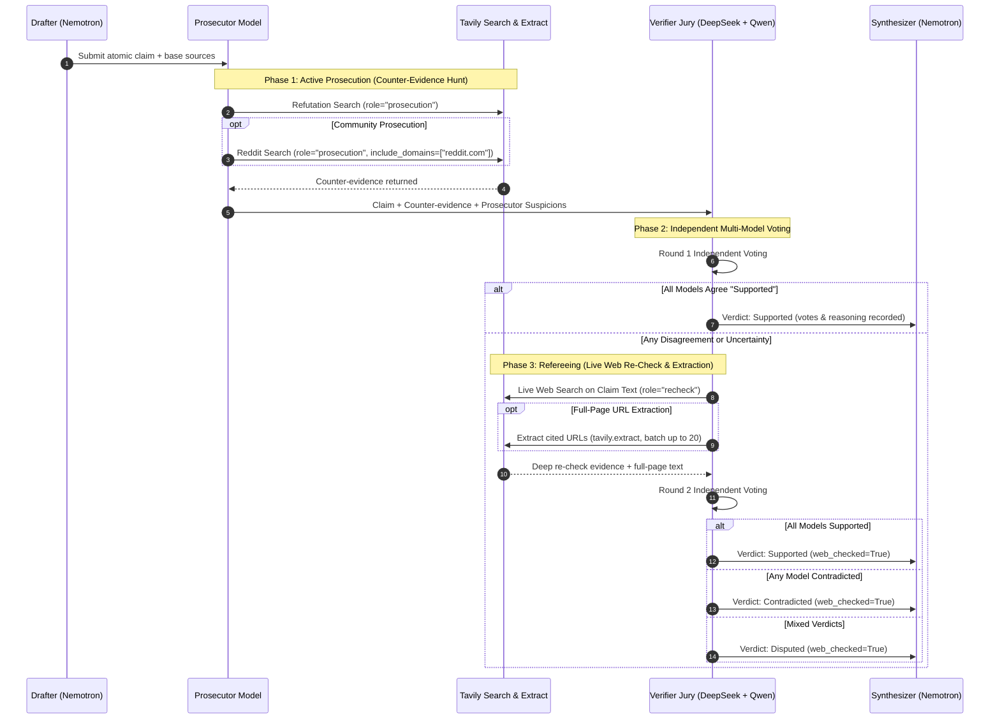

# Vera — Research that knows you, and proves it.

> Deep research tools give every user the same stateless answer and cite sources nobody checked.  
> Vera remembers who you are and what you already researched, then adversarially verifies every single claim across multiple NVIDIA open models before it reaches you.

[](docs/Submissions.md)
[](https://build.nebius.com/)
[](docs/DECISIONS.md)
[](https://tavily.com/)
[](backend/tests/)
[](docs/ARCHITECTURE.md)
[](LICENSE)

---

## ⚡ Quickstart & Setup Instructions

Get Vera running locally in under 3 minutes.

### 📋 Prerequisites
- **Python**: `3.10` or higher (`3.11` recommended)
- **Node.js**: `18.0` or higher (Node `20+` recommended) & `npm`
- **Nebius Token Factory API Key**: [Get API Key at build.nebius.com](https://build.nebius.com/)
- **Tavily Search API Key**: [Get API Key at tavily.com](https://tavily.com/)

---

### 1️⃣ Clone & Configure Environment

```bash
git clone https://github.com/Siddhant75/vera.git
cd vera

# Copy environment template
cp .env.example .env
```

Edit `.env` and fill in your API credentials:
```env
TOKEN_FACTORY_API_KEY=your_nebius_api_key_here
TAVILY_API_KEY=your_tavily_api_key_here
TOKEN_FACTORY_BASE_URL=https://api.tokenfactory.nebius.com/v1

# Models served on Nebius Token Factory
PLANNER_MODEL=nvidia/nemotron-3-super-120b-a12b
VERIFIER_MODELS=deepseek-ai/DeepSeek-V4-Pro,Qwen/Qwen3-235B-A22B-Instruct-2507
```

---

### 2️⃣ Start Backend Server (FastAPI)

In your first terminal:
```bash
# Navigate to backend
cd backend

# Create & activate virtual environment
python -m venv .venv

# Windows (PowerShell):
.venv\Scripts\Activate.ps1
# macOS / Linux:
source .venv/bin/activate

# Install dependencies
pip install -r requirements.txt

# Run backend server (starts on http://127.0.0.1:8000)
uvicorn app.main:app --reload --host 127.0.0.1 --port 8000
```
*Health check:* Verify backend telemetry at `curl http://127.0.0.1:8000/api/telemetry`

---

### 3️⃣ Start Frontend Server (Vite + React)

In a second terminal:
```bash
cd frontend

# Install dependencies
npm install

# Start Vite dev server (starts on http://localhost:5173)
npm run dev
```

Open **`http://localhost:5173`** in your browser.

---

### 4️⃣ Verification & Test Suite

Vera includes a comprehensive, 100% mock-isolated test suite that verifies end-to-end pipeline orchestration, budget boundaries, privacy gates, and multi-model consensus logic without consuming live API tokens:

```bash
# Run all 202 backend tests (executes in ~12 seconds)
pytest backend/tests

# Run frontend linter and production bundle build
cd frontend
npm run lint
npm run build
```

---

## 🎯 Guidance for Running & Testing Vera

Once open at `http://localhost:5173`, follow this guided evaluation workflow:

1. **Execute the Hero Research Run**:
   - The sample brief (*"Should our startup adopt Kubernetes or serverless for our new ML inference API?"*) is pre-filled.
   - Click **Run Research** and observe the live multi-agent execution pipeline:
     - **Planning**: Decomposes the brief into persona-specific sub-questions.
     - **Searching**: Parallel Tavily queries ground every angle.
     - **Drafting**: Extracts structured factual claims with citation requirements.
     - **Verifying**: Live claims preview streams as models cross-examine facts.
2. **Examine Dual-Tier Telemetry**:
   - The top telemetry bar clearly separates **`⚡ THIS RUN`** (~49k–120k tokens) from **`🌐 SESSION TOTAL`**, demonstrating exact marginal cost economics without confusing a single query with cumulative usage.
3. **Inspect the Adversarial Verification Proofs**:
   - Scroll down to **Verified Claims**. The first load-bearing claim is auto-expanded by default.
   - Notice the **`⚖️ Prosecutor's counter-evidence hunt`** where Vera actively searched for refutations, and read the independent reasoning from the **Model Votes** (Nemotron, DeepSeek, Qwen).
4. **Export Full Research Draft (1-Click Markdown)**:
   - Click the **Full Research Draft (Markdown)** tab at the top of the report.
   - Inspect the compiled, unabridged research paper with inline verdict markers (`[SUPPORTED]`, `[CONTRADICTED]`).
   - Click **📋 Copy Draft to Clipboard** for instant export into your knowledge base (Obsidian, Notion, Docs).
5. **Evaluate the Tavily Transparency Pool**:
   - In the Executive Report, inspect the **16 Authoritative Domain Cards**, then scroll to the **Transparency Pool (Evaluated Web Evidence)**.
   - Click to expand: Vera shows every live web source Tavily retrieved that was filtered out as redundant or unverified, ensuring complete provenance.
6. **Run a Repeat Delta Query ("What Changed")**:
   - Keep the topic tag as `k8s vs serverless` and click **Run Delta (what changed)**.
   - Unchanged sub-questions skip LLM and search calls; Vera highlights the **What changed since your last research** delta box with confirmed, reversed, or updated claims.
7. **Test Private Notes & Memory Restoration**:
   - Click **🔒 Private notes** and add an internal constraint (*"we are bound to k8s by a platform mandate"*). The deterministic privacy gate ensures this note guides planning without leaking to search engines.
   - Open **🧠 What Vera remembers** and click **View ↗** on any past research run to instantly restore its report and sync its historical telemetry.

---

## 💡 The Core Problem & Architectural Insight

- **Every deep-research tool is stateless**: Tools like `gpt-researcher`, `smolagents`, or Perplexity treat every query as day zero. They have no memory of your role, your trusted domains, your prior conclusions, or your proprietary constraints.
- **Citation quality is broken across the field**: Standard RAG pipelines cite links nobody verified, often hallucinating citations from snippet noise.
- **Vera's Insight — Model Disagreement is a Feature**: Single-model systems suffer from self-confirmation bias and sycophancy. In Vera, **model disagreement is treated as an active investigative signal**. When independent models disagree, Vera triggers an automated referee pass across the live web to find the truth.

---

## 🚀 How NVIDIA Nemotron & Open Models Power Vera

Single-model APIs create an echo chamber. Vera treats verification as an adversarial trial powered by **diverse open models** served on **Nebius Token Factory**:

```
                       ┌──────────────────────────────────────────────┐
                       │   NVIDIA Nemotron-3-Super-120B (Planner)    │
                       │   - Decomposes brief into persona questions │
                       └──────────────────────┬───────────────────────┘
                                              │
                       ┌──────────────────────▼───────────────────────┐
                       │   NVIDIA Nemotron-3-Super-120B (Drafter)    │
                       │   - Extracts atomic claims with source URLs │
                       └──────────────────────┬───────────────────────┘
                                              │
                       ┌──────────────────────▼───────────────────────┐
                       │             Adversarial Verification         │
                       │  - Prosecutor hunts counter-evidence (Tavily)│
                       │  - Independent Multi-Model Jury:             │
                       │    * NVIDIA Nemotron                         │
                       │    * DeepSeek-V4-Pro                         │
                       │    * Qwen3-235B-Instruct                     │
                       └──────────────────────┬───────────────────────┘
                                              │
                       ┌──────────────────────▼───────────────────────┐
                       │   NVIDIA Nemotron-3-Super-120B (Synthesizer)│
                       │   - Verdict-weighted Executive Report        │
                       │   - Full Unabridged Markdown Draft           │
                       └──────────────────────────────────────────────┘
```

### 1. NVIDIA Nemotron-3-Super-120B: The Orchestration Core
- **Persona-Driven Planning**: Nemotron analyzes the user's role (`engineer`, `founder`, `analyst`) and breaks complex briefs into 3 to 8 targeted sub-questions. It determines depth tiers (`quick`, `standard`, `deep`) and enforces deterministic search ceilings.
- **Strict Citation-Grounded Drafting**: Nemotron extracts atomic claims strictly bound to fetched URLs. Uncited assertions are discarded before verification even begins.
- **Executive Synthesis & Markdown Compilation**: Nemotron synthesizes the final report, generating an executive **Bottom Line (≤80 words)**, section narratives weighted by claim verdicts, and compiling the full research draft for 1-click Markdown export.

### 2. The Multi-Model Jury: DeepSeek-V4-Pro + Qwen3-235B
- **Independent Quorum**: Vera passes the drafted claims and the prosecutor's counter-evidence to an independent multi-model jury (`deepseek-ai/DeepSeek-V4-Pro` and `Qwen/Qwen3-235B-A22B-Instruct-2507`).
- **Adversarial Dispute Resolution**: If the models disagree on whether a claim is supported, Vera doesn't take an average—it initiates a live web referee re-check with full-page text extraction (`tavily.extract`) to resolve the discrepancy with primary evidence.

---

## ⚡ How Nebius Token Factory Accelerated Our Workflow

Developing an adversarial, multi-agent research assistant requires orchestrating dozens of concurrent LLM calls per query. **Nebius Token Factory** was foundational to building Vera:

1. **Ultra-Low Latency & High Token Throughput**:
   - A single deep-research query involves up to 40 LLM interactions across planning, drafting, prosecutor hypotheses, and multi-model jury voting.
   - Nebius Token Factory's optimized inference infrastructure executes full 120,000-token multi-model research runs in **~45 seconds**, eliminating the latency bottlenecks common in traditional API providers.
2. **Unified OpenAI-Compatible API Gateway**:
   - Nebius Token Factory hosts heterogeneous state-of-the-art open models (NVIDIA Nemotron, DeepSeek, Qwen) behind a **single standardized API endpoint** (`https://api.tokenfactory.nebius.com/v1`).
   - This eliminated the need to maintain different SDKs, credential managers, or protocol adapters. Our Python asynchronous client communicates with all three models seamlessly.
3. **Predictable Per-Token Economics**:
   - Token Factory's transparent pricing enabled Vera's **dual-tier telemetry engine**. Vera measures exact input/output tokens in real time, giving users total confidence in the cost-efficiency of every run (~49k–120k tokens per query).
4. **Concurrency Without Throttling**:
   - When the verifier broadcasts claims to multiple jury models simultaneously, Token Factory handles the parallel fan-out without rate-limit drops or queue stalling.

---

## 🔍 Tavily 6-Role Integration Matrix (Best Use of Tavily)

Vera does not use Tavily as a simple search bar replacement. Instead, Tavily acts as an active referee embedded across **six distinct operational roles**:

| Role | API Endpoint / Mode | Search Strategy & Filters | Pipeline Purpose |
| :--- | :--- | :--- | :--- |
| **1. Grounding** | `/search` | `include_domains_mode: "prefer"`, `exclude_domains` | Gathers initial live web evidence per sub-question, prioritizing user-trusted domains. |
| **2. Active Prosecution** | `/search` | `exclude_domains` (unbiased by trusted sources) | Searches explicitly for counter-evidence, disproven benchmarks, and contradictory facts. |
| **3. Community Prosecution** | `/search` | `include_domains: ["reddit.com"]` | Mines real-world practitioner experiences, post-mortems, and deployment complaints on Reddit. |
| **4. Referee Re-Check** | `/search` (role=`recheck`) | Precise claim text query, fresh indexing | Triggered automatically when jury models disagree to fetch tie-breaking evidence. |
| **5. Full-Page Extraction** | `/extract` | Batch up to 20 URLs cited by the claim | Pulls full-page DOM markdown to resolve snippet truncation errors when claims are disputed. |
| **6. Transparency Pool** | In-memory diff | Trust-filtered, cited sources removed | Surfaces up to 30 evaluated but discarded web sources with clear provenance explanation. |

---

## ⚖️ The Adversarial Verification Protocol (The Core Moat)



---

## 📐 Deterministic Sizing & Depth Tiers

The planner classifies each brief's depth (`quick` / `standard` / `deep`), and deterministic code enforces hard ceilings across the pipeline:

| Tier | Sub-Questions | Search Budget | Claims / Question | Refutation Search | Typical Measured Token Burn & Latency |
| :--- | :---: | :---: | :---: | :---: | :---: |
| **`quick`** | 3 | 8 | 3 | Skipped (suspicions only) | ~49K tokens · ~36s |
| **`standard`** | 5 | 14 | 4 | Full refutation + community | ~120K tokens · ~45s |
| **`deep`** | 8 | 20 (or formula) | 5 | Full refutation + community | ~180K–220K tokens · ~60s |

*Formula for bulleted briefs:* `min(12 + 2 × requirements, 40)` searches. Code owns the budget—it never prompt-hopes.

---

## 🔒 Security & Privacy by Construction

Vera stores everything locally in SQLite (`vera.db` in WAL mode) with zero external database dependencies or telemetry tracking:

Two hard rules, enforced in deterministic code — not prompts:
1. **Verbatim note text never reaches Tavily**: Every search query is inspected before dispatch. 4-gram overlap with your private notes, or any distinctive-token overlap on short queries, immediately replaces the query with the sanitized topic slug.
2. **Secrets are warned at save-time, never silently leaked**: Vera scans for API key, password, private key, and token patterns, warning you before saving confidential text.

**Never paste into notes:** passwords, private keys, or credentials. Notes live on your machine, but their context is processed by Nebius Token Factory during research. You can purge all memory anytime from the UI (*"What Vera remembers"* → type `DELETE` → Purge all).

---

## 🚀 Deployment & Ops

- **One-Click Deploy**: Ships a [`render.yaml`](render.yaml) blueprint. Point Render at this repository, paste your `TOKEN_FACTORY_API_KEY` and `TAVILY_API_KEY`, and both FastAPI backend and Vite frontend deploy seamlessly.
- **Production Demo Posture**:
  - The watcher loop is off by default (`WATCH_INTERVAL_MINUTES=0`). Set to `30` on deployed instances for automatic background topic tracking.
  - Public demo instances can enforce `DAILY_TOKEN_BUDGET=2000000` and `MAX_WATCHES=5` to prevent token farming.
- **Zero-Burn Watcher**: The watcher probes each topic with 1 low-cost Tavily search and only wakes the LLMs when content actually changed.

---

## 🔥 Engineering Challenges & Accomplishments

- **Structured Output on Reasoning Models**: Token Factory's Nemotron reasoning models garbled output when using standard `response_format=json_schema`. We transitioned all structured calls to schema-in-prompt + regex brace extraction with token escalation and retries.
- **Taming Verifier Greed**: The first live run drafted 84 claims. We replaced prompt hopes with deterministic code caps: 3–5 claims per sub-question, budgeted searches, and evidence caps. **Result: 45 → 16 searches, 411K → 120K tokens (−71%)** with healthier verdict distributions.
- **The Moat is the Constraint**: Single-model APIs cannot do adversarial multi-model verification. What the rules forbid (one model) is exactly what makes Vera's core work — the sponsor constraint IS the engine.
- **Privacy in Code, Not Prompts**: A deterministic gate sits at every Tavily dispatch site; honestly scoped (verbatim text and short echoes blocked) and thoroughly tested.

---

## 🔭 What's Next

- **Persistent Hosted Volumes**: Managed disk mount for hosted deployments (preserving SQLite memory across container spin-downs).
- **Watch Run History Timeline**: Visual delta timeline per watched topic.
- **Automated Webhook Alerts**: Slack/Discord webhook alerts for verified topic deltas.

---

## 📄 License

Apache 2.0 — Original implementation engineered for the Nebius x NVIDIA Global AI Hackathon.
