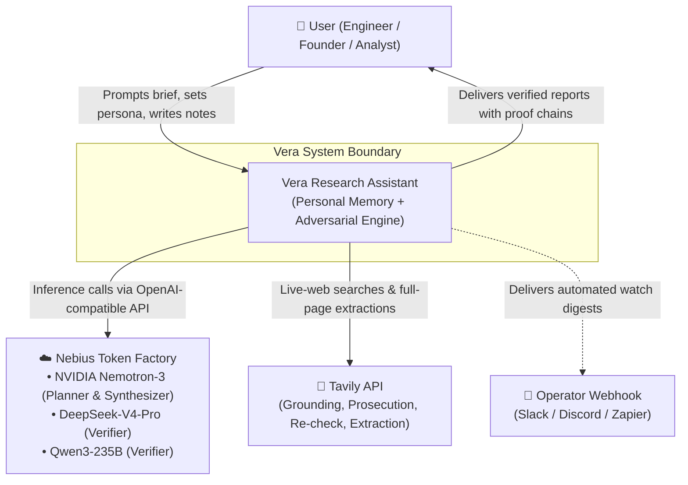
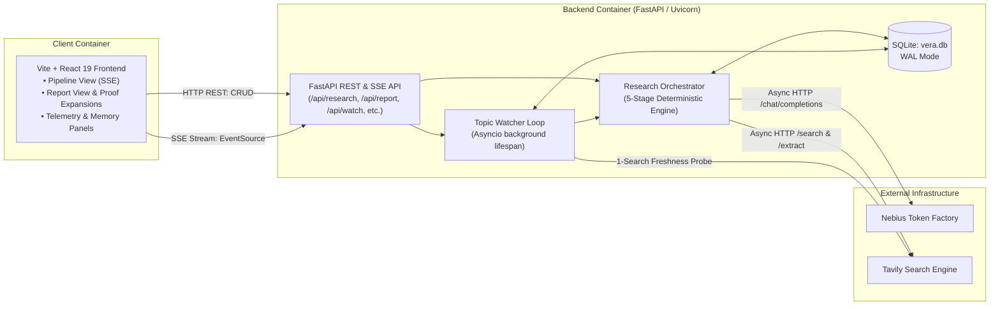
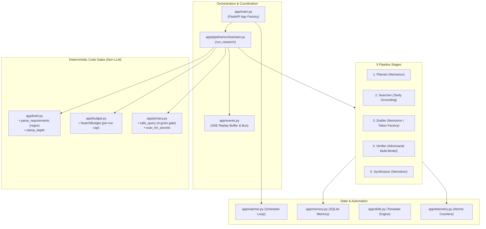
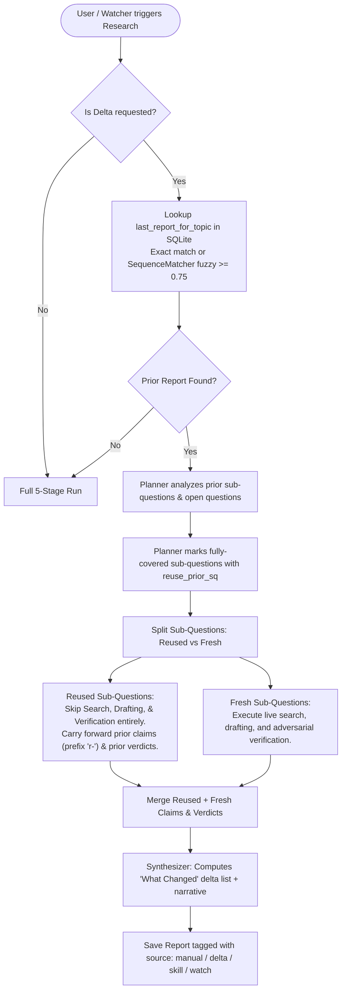
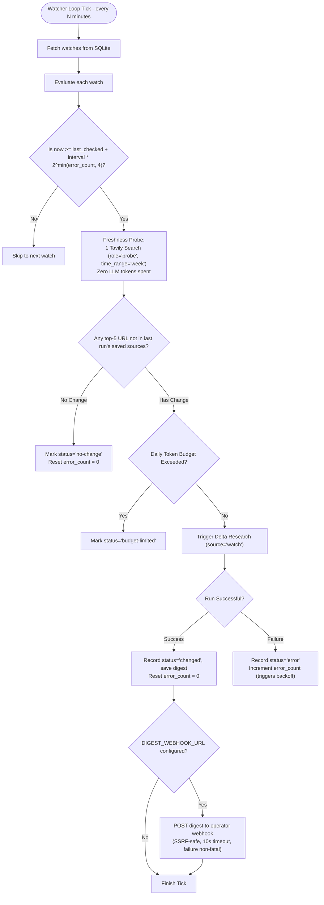

# Vera — Architecture & System Design

> **"Research that knows you, and proves it."**  
> Vera is a personal deep research assistant built on **Nebius Token Factory**, **NVIDIA Nemotron**, and **Tavily**. This document details the architectural design, component boundaries, adversarial verification protocol, and deterministic privacy/budget subsystems.

---

## 1. High-Level System Context (C4 Level 1)

Vera operates as a private, single-tenant research assistant. It interacts with the user via a responsive web client, runs all model inference through Nebius Token Factory, grounds every claim using Tavily, and optionally delivers digests to operator webhooks.



---

## 2. Container Architecture (C4 Level 2)

Vera is packaged into two primary deployable containers (unified via `render.yaml`):



---

## 3. Component Architecture (C4 Level 3)

The backend (`backend/app/`) is modularized with clean separation between the execution pipeline, deterministic safety gates, and storage subsystems.



---

## 4. Core Workflows & Sequence Diagrams

### 4.1 The Adversarial Verification Protocol (The Core Moat)

Unlike single-model systems that simply ask a model "is this true?", Vera treats verification as an adversarial trial with active prosecution and independent juries:

```mermaid
sequenceDiagram
    autonumber
    participant D as Drafter (Nemotron)
    participant P as Prosecutor Model
    participant T as Tavily Client
    participant V as Verifier Models (DeepSeek + Qwen)
    participant O as Orchestrator

    D->>O: Drafted atomic claims with cited URLs
    O->>P: Submit Claim text + Base Evidence
    
    Note over P,T: 1. Active Prosecution (Hunt for Counter-Evidence)
    P->>P: Analyze weaknesses & formulate refutation query
    alt Refutation Search Eligible (Standard or Deep Tier)
        P->>T: Refutation Search (role="prosecution", exclude_domains=banned)
        T-->>P: Counter-evidence
        opt Community Prosecution (Reddit)
            P->>T: Search Reddit (role="prosecution", include_domains=["reddit.com"])
            T-->>P: Practitioner counter-evidence
        end
    else Quick Tier or Budget Out
        Note over P: Skip refutation search; suspicions stand
    end

    Note over V: 2. Round 1 Independent Voting
    P->>V: Claim + Base Evidence + Prosecution Evidence + Flagged Feedback
    V->>V: Parallel voting (supported / contradicted / uncertain)

    alt All Models Agree "Supported"
        V->>O: Verdict: Supported (votes recorded)
    else Any Disagreement or Uncertainty
        Note over V,T: 3. Refereeing: Live Web Re-Check & Extraction
        O->>T: Live Web Search on Claim Text (role="recheck")
        T-->>O: Fresh search results
        opt Full-Page Extraction
            O->>T: Extract cited URLs (tavily.extract, batch <= 20)
            T-->>O: Full page text (kills snippet truncation errors)
        end
        O->>V: Round 2 Voting with deep evidence
        V->>V: Re-vote
        alt All Models Supported
            V->>O: Verdict: Supported (web_checked=True)
        else Any Model Contradicted
            V->>O: Verdict: Contradicted (web_checked=True)
        else Mixed Verdicts
            V->>O: Verdict: Disputed (web_checked=True)
        end
    end
```

---

### 4.2 True Delta Research & Artifact Reuse Flow

When a user or watcher investigates a topic previously researched, Vera avoids redundant API and token burn by executing a true delta:



---

### 4.3 Always-On Topic Watcher & Freshness Probe

The watcher loop (`backend/app/watcher.py`) provides continuous intelligence without idling token costs:



---

## 5. Deterministic Code Gates vs. Prompt-Hopes

A core design tenet of Vera is that **critical policies must be enforced in deterministic Python code, never trusted to LLM prompt instructions**:

```
┌─────────────────────────────────────────────────────────────────────────────┐
│                       DETERMINISTIC CODE GATES                               │
├──────────────────────────┬──────────────────────────────────────────────────┤
│ Mechanism                │ Code Implementation & Guarantee                  │
├──────────────────────────┼──────────────────────────────────────────────────┤
│ Search Budget Cap        │ `app/budget.py`: Priority-ordered atomic counter  │
│                          │ (Searcher -> Prosecutor -> Recheck -> Extract).  │
│                          │ Degrades visibly, never crashes or overspends.   │
├──────────────────────────┼──────────────────────────────────────────────────┤
│ Requirement Coverage     │ `app/brief.py` + `orchestrator.py`: Regex-parsed │
│                          │ bullets. Planner re-prompted on missed items;    │
│                          │ uninvestigated items explicitly flagged.         │
├──────────────────────────┼──────────────────────────────────────────────────┤
│ Privacy Gate             │ `app/privacy.py`: 4-gram overlap + distinctive   │
│                          │ token check at all Tavily dispatch sites.        │
│                          │ Replaces leaking query with safe topic slug.     │
├──────────────────────────┼──────────────────────────────────────────────────┤
│ Citation Integrity       │ `app/pipeline/drafter.py`: Set intersection      │
│                          │ against fetched URLs. Uncited claims dropped.     │
├──────────────────────────┼──────────────────────────────────────────────────┤
│ Output Word & Claim Caps │ Strict slice limits: ≤5 claims/sq, ≤120 words    │
│                          │ per section narrative, ≤80 words bottom line.     │
├──────────────────────────┼──────────────────────────────────────────────────┤
│ Watcher Backoff          │ Exponential `2^min(error, 4)` backoff prevents    │
│                          │ hammering failed probes or external APIs.        │
└──────────────────────────┴──────────────────────────────────────────────────┘
```

---

## 6. Tavily 6-Role Integration Matrix

Tavily is utilized as a deep, multi-faceted evidence engine rather than a mere search wrapper:

| Role | Client Method / Role String | Query Personalization / Filters | Pipeline Purpose |
| :--- | :--- | :--- | :--- |
| **1. Grounding** | `search(..., role="grounding")` | `include_domains` (`prefer`), `exclude_domains` | Live web evidence for each planned sub-question. |
| **2. Prosecution** | `search(..., role="prosecution")` | `exclude_domains` (strictly un-biased by trusted sources) | Hunts for counter-evidence proposing reasons a claim is wrong. |
| **3. Community** | `search(..., role="prosecution")` | `include_domains: ["reddit.com"]` | Gathers real-world practitioner counter-evidence on Reddit. |
| **4. Refereeing** | `search(..., role="recheck")` | Claim text query, `exclude_domains` | Triggered only upon model voting disagreement to provide fresh signals. |
| **5. Full-Page Extract** | `extract(urls[:20])` | Claim text query, batch ≤ 20 | Extracts raw page text for cited sources to prevent snippet truncation errors. |
| **6. Transparency Pool**| In-memory set difference | Trust-filtered, cited sources removed | Surfaces up to 30 fetched-but-uncited sources for auditability (0 extra API cost). |

---

## 7. Database Schema (`vera.db`)

SQLite in `PRAGMA journal_mode=WAL` with zero external dependencies:

```sql
-- User Profile & Personalization
CREATE TABLE profile (
    key TEXT PRIMARY KEY,
    value TEXT NOT NULL
);

-- Research Runs (server-owned provenance)
CREATE TABLE runs (
    id INTEGER PRIMARY KEY AUTOINCREMENT,
    run_uuid TEXT UNIQUE,
    brief TEXT NOT NULL,
    persona TEXT NOT NULL,
    topic_key TEXT NOT NULL,
    report_json TEXT NOT NULL,
    created_at TEXT NOT NULL DEFAULT (datetime('now')),
    source TEXT NOT NULL DEFAULT 'manual' -- 'manual' | 'delta' | 'skill' | 'watch'
);

-- Claim Verdicts & Proofs
CREATE TABLE verdicts (
    run_uuid TEXT NOT NULL,
    claim_id TEXT NOT NULL,
    verdict TEXT NOT NULL,
    reason TEXT NOT NULL,
    model TEXT NOT NULL,
    web_checked INTEGER NOT NULL DEFAULT 0
);

-- Private Topic Notes
CREATE TABLE notes (
    id INTEGER PRIMARY KEY AUTOINCREMENT,
    topic_key TEXT NOT NULL,
    content TEXT NOT NULL,
    created_at TEXT NOT NULL DEFAULT (datetime('now'))
);

-- Topic Watchers
CREATE TABLE watches (
    id INTEGER PRIMARY KEY AUTOINCREMENT,
    topic TEXT NOT NULL,
    brief TEXT NOT NULL,
    persona TEXT NOT NULL,
    interval_hours INTEGER NOT NULL,
    last_checked TEXT,
    last_run_uuid TEXT,
    last_status TEXT,
    last_changes INTEGER,
    last_digest TEXT,
    error_count INTEGER NOT NULL DEFAULT 0
);

-- Research Skills (Reusable Recipes)
CREATE TABLE skills (
    name TEXT PRIMARY KEY,
    persona TEXT NOT NULL,
    brief_template TEXT NOT NULL,
    topic TEXT NOT NULL,
    trusted_sources TEXT NOT NULL DEFAULT '',
    excluded_sources TEXT NOT NULL DEFAULT ''
);

-- Fetched Sources Audit Trail
CREATE TABLE sources (
    run_uuid TEXT NOT NULL,
    url TEXT NOT NULL,
    title TEXT NOT NULL
);

-- User Feedback on Claims (Feeds into verifier strictness)
CREATE TABLE feedback (
    run_uuid TEXT NOT NULL,
    claim_id TEXT NOT NULL,
    helpful INTEGER NOT NULL,
    claim_text TEXT NOT NULL DEFAULT ''
);
```
